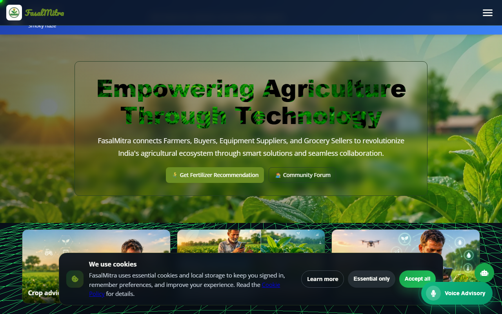
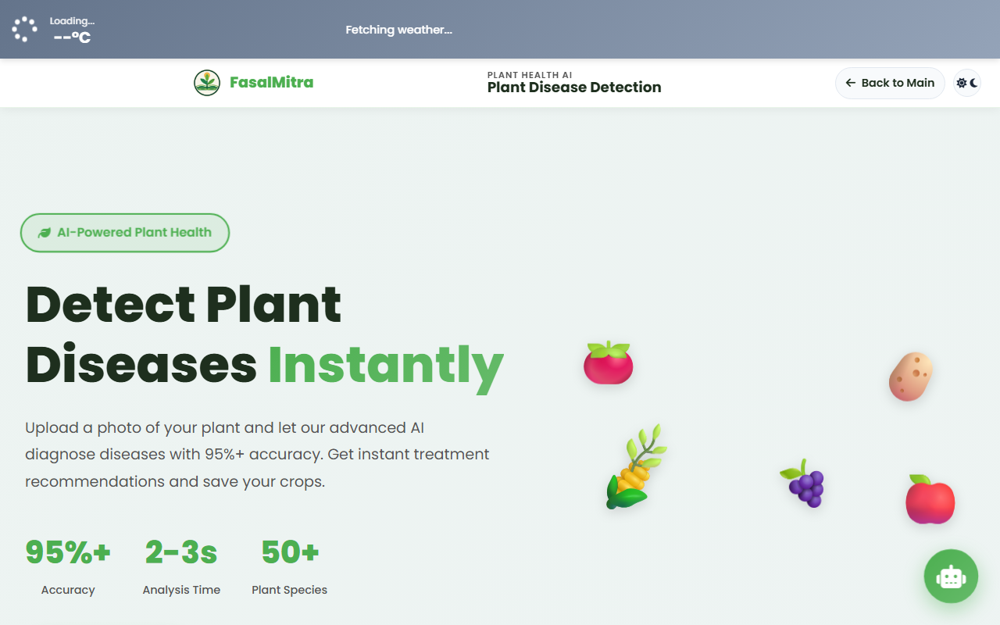
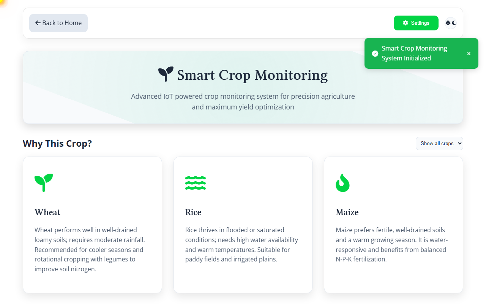
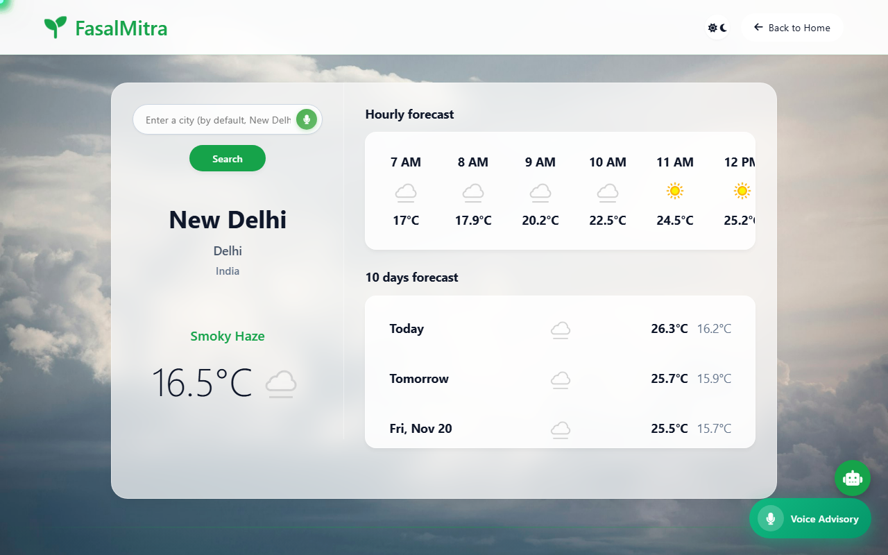
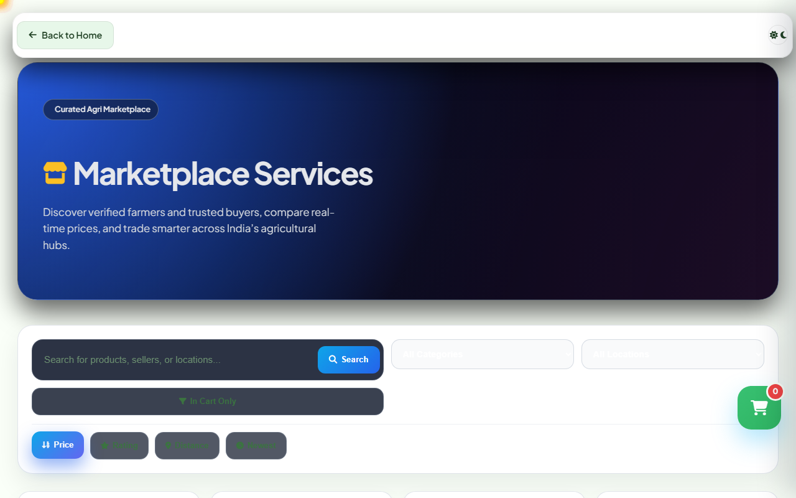
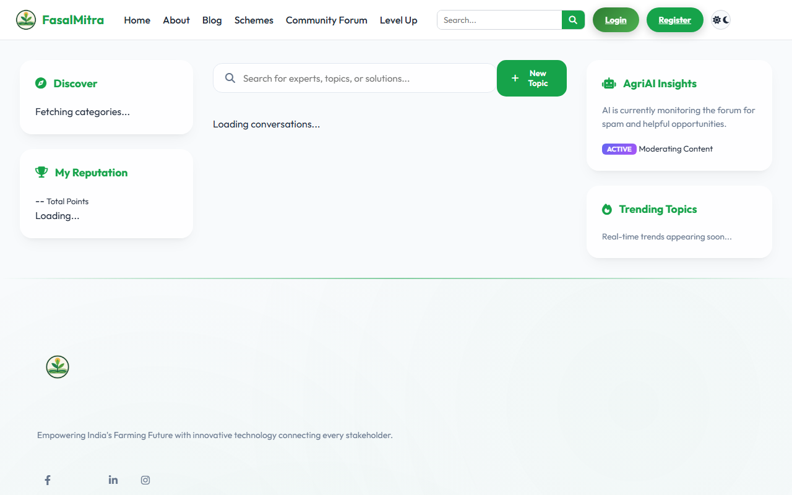
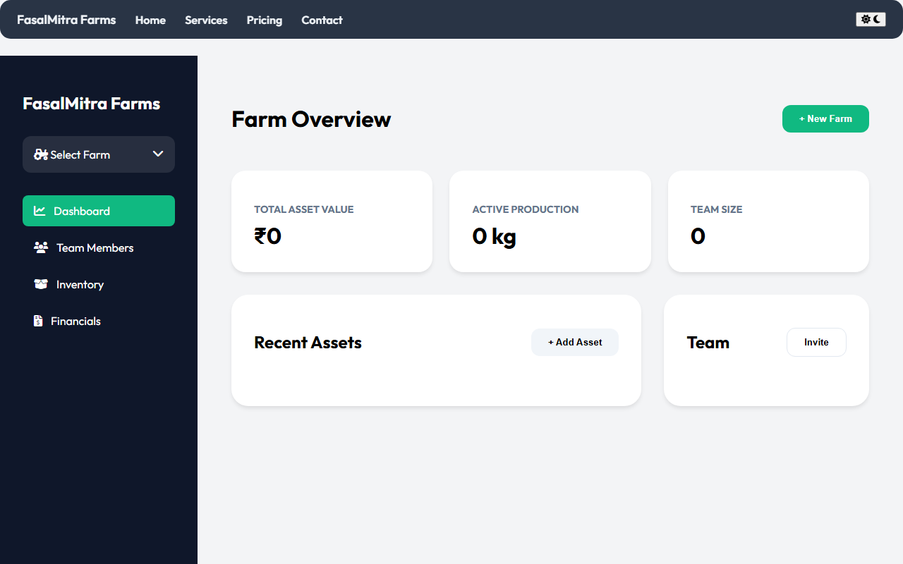
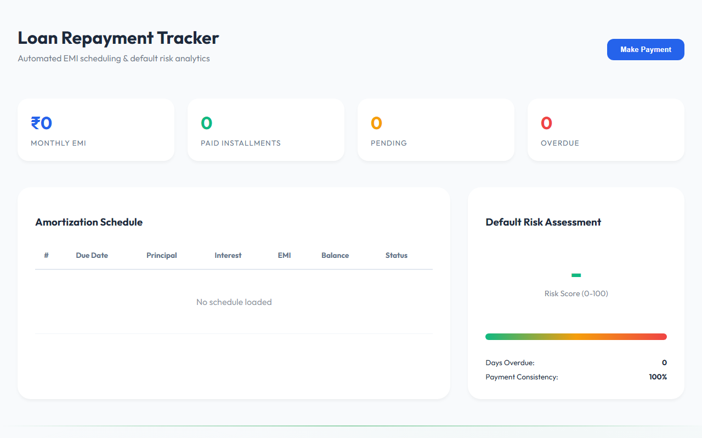

<div align="center">


# 🌱 FasalMitra — Smart Farming Platform

### *Kheti ko Smarter Banao | Empowering India's 140M Farming Households*

[](https://swoc.tech)
[](LICENSE)
[](CONTRIBUTING.md)
[](https://python.org)
[](https://flask.palletsprojects.com)
[](https://tensorflow.org)
[](https://pytorch.org)

</div>

---

## 📌 Table of Contents

- [🌍 The Problem We Solved](#-the-problem-we-solved)
- [💡 What is FasalMitra?](#-what-is-fasalmitra)
- [🖥️ Application Preview](#️-application-preview)
- [✨ Core Features](#-core-features)
- [🗺️ System Architecture](#️-system-architecture)
- [🤖 AI & ML Models](#-ai--ml-models)
- [🛠️ Tech Stack](#️-tech-stack)
- [📂 Project Structure](#-project-structure)
- [🚀 Quick Start](#-quick-start)
- [🔌 API Reference](#-api-reference)
- [⚙️ Environment Variables](#️-environment-variables)
- [🔐 Security](#-security)
- [🛣️ Roadmap](#️-roadmap)
- [🤝 Contributing](#-contributing)
- [📄 License](#-license)

---

## 🌍 The Problem We Solved

> **India loses ₹90,000 crore worth of crops annually due to disease, poor planning, and lack of access to expert advice.**

| Problem | Scale |
|---------|-------|
| 🦠 Plant disease misidentification | 35% of crop yield lost every year |
| 👨‍🌾 No agronomist access | Only 1 agronomist per 800+ farmers |
| 🌐 Language & literacy barrier | Most advisory in English — inaccessible to rural farmers |
| 💊 Wrong pesticide use | ₹9,000 Cr wasted annually on incorrect pesticides |
| 🏦 No formal credit access | 70% of small farmers excluded from institutional credit |
| 🌦️ No hyperlocal weather advisory | Farmers rely on guesswork for planting decisions |

**FasalMitra** solves all of these with a single AI-powered platform accessible from any smartphone browser.

---

## 💡 What is FasalMitra?

**FasalMitra** (meaning *"Crop Friend"* in Hindi) is a **full-stack AI-powered smart agriculture platform** that connects farmers with:

- 🤖 AI disease detection from leaf images
- 🌾 Personalized crop & fertilizer recommendations
- 🤝 Peer-to-peer farmer community
- 🏛️ Government scheme finder
- 🏦 Smart loan & insurance portal
- 📦 Supply chain & marketplace
- 🌦️ Hyperlocal weather advisory
- 💬 Multilingual AI chatbot in 10 Indian languages

> **A farmer clicks a photo of a sick leaf → uploads to FasalMitra → gets disease name, confidence score, and actionable remedy in seconds — in their own language.**

---

## 🖥️ Application Preview

> 📸 Real screenshots captured directly from the live FasalMitra web application

### 🏠 Homepage — Empowering Agriculture Through Technology


*FasalMitra's hero landing page — connects Farmers, Buyers, Equipment Suppliers and Grocery Sellers to revolutionize India's agricultural ecosystem. Features cookie consent, Voice Advisory bot, and real-time weather strip.*

---

### 🔬 AI Plant Disease Detection


*Upload any plant leaf photo → CNN model diagnoses with **95%+ accuracy** in 2–3 seconds. Supports 50+ plant species. Shows disease name, confidence score, and treatment recommendations.*

---

### 🌾 Smart Crop Monitoring & Recommendation


*IoT-powered Smart Crop Monitoring System — recommends crops (Wheat, Rice, Maize etc.) based on soil type, season, and rainfall. Advanced precision agriculture for maximum yield optimization.*

---

### 🌦️ Real-Time Weather Dashboard


*Live weather data for any Indian city — current temperature, hourly forecast, and 10-day weather prediction. Helps farmers plan irrigation, sowing, and harvesting schedules.*

---

### 🛒 Agricultural Marketplace


*Curated Agri Marketplace — discover verified farmers and trusted buyers, compare real-time prices, and trade smarter across India's agricultural hubs. Features search, filters by price/rating/distance.*

---

### 🏛️ Government Schemes Portal


*Comprehensive database of government agricultural schemes, subsidies, and financial support programs. Farmers can browse eligibility criteria and apply directly.*

---

### 👥 Community Forum


*Farmer community platform — discuss challenges, share solutions, exchange crop tips, and stay updated with the latest in agriculture and agri-tech.*

---

### 📊 Farm Analytics Dashboard


*Comprehensive farm management dashboard — track crop cycles, monitor IoT sensor data, manage inventory, and get AI-powered insights for data-driven farming decisions.*

---

### 🤖 AI Chat Assistant


*Intelligent farming assistant powered by NLP — answers crop queries, provides disease remedies, and gives weather-based advice in multiple languages including Hindi.*

---

### 💰 Loan & Finance Dashboard


*Smart Loan Management — track loan applications, EMI schedules, interest calculations, and government credit schemes. Helps farmers access formal financial services.*

---

### 🔐 Secure Login & Registration


*JWT-secured authentication with drone aerial background. Supports login, registration, forgot password, and OTP verification.*

---

## ✨ Core Features

### 🔬 1. AI Plant Disease Detection
Upload a photo of any plant leaf → CNN model (PlantDiseaseNet) classifies it into one of **21 disease/healthy classes** with confidence score and treatment recommendation.

- **Model:** Custom ResNet-style CNN (6.6M parameters)
- **Dataset:** PlantVillage (54,306 labeled images)
- **Input:** Any leaf image (JPEG/PNG)
- **Output:** Disease name + pathogen + remedy + confidence %
- **Speed:** ~180ms inference on CPU

**Supported crops & diseases:**
| Crop | Diseases Detected |
|------|-------------------|
| 🍅 Tomato | Late Blight, Early Blight, Bacterial Spot, Leaf Mold, Septoria Spot, Spider Mites, Target Spot, Yellow Leaf Curl Virus, Mosaic Virus, Healthy |
| 🥔 Potato | Early Blight, Late Blight, Healthy |
| 🍎 Apple | Black Rot, Healthy |
| 🌽 Corn | Cercospora Leaf Spot, Common Rust, Healthy |
| 🍇 Grape | Black Rot, Esca, Healthy |

---

### 🌾 2. Crop Recommendation System
Recommends the best crop to grow based on real-time soil and climate parameters.

**Input parameters:** N, P, K levels · Soil pH · Temperature · Humidity · Rainfall  
**Model:** Random Forest Classifier + XGBoost ensemble  
**Output:** Top-3 recommended crops with suitability score

---

### 🧪 3. Fertilizer Recommendation
Based on crop type, soil nutrients and deficiency detection, recommends exact fertilizer type and quantity.

---

### 📈 4. Crop Yield Prediction
Predicts expected yield (kg/hectare) using historical data, satellite spatial grids, weather forecast & soil health scores.  
**Model:** XGBoost Regressor + Temporal Prophet Engine

---

### 💬 5. FasalMitra — AI Chatbot
24/7 multilingual farming assistant powered by **Google Gemini 2.5 Flash**.
- Answers farming questions in **10 Indian languages**
- Analyzes uploaded plant photos for disease diagnosis
- **Offline fallback:** JSON-based rule engine when internet is unavailable

---

### 🏛️ 6. Government Scheme Finder
Automatically matches farmers to eligible central and state government subsidies based on state, crop type, farm size, and income level.

---

### 🌦️ 7. Hyperlocal Weather Advisory
Real-time weather + 7-day forecast with crop-specific alerts, drought/frost/flood early warnings, and planting window recommendations.

---

### 🏦 8. Smart Loan & Insurance Portal
AI-powered loan eligibility check, KCC application assistance, PMFBY crop insurance, default risk scoring + repayment scheduling.

---

### 📦 9. Supply Chain & Marketplace
Direct farmer-to-buyer connections, real-time mandi price tracker, freight booking, QR-code produce traceability, cold storage management.

---

### 👥 10. Community Forum & Knowledge Hub
Farmer-to-farmer Q&A forum, expert-verified answers, multilingual blog, peer knowledge sharing with reputation system.

---

### 🌱 11. Sustainability & Carbon Portal
Carbon credit calculation for organic/no-till practices, ESG market listings, regenerative farming score, soil health satellite tracking.

---

### 🔧 12. IoT & Precision Agriculture
Real-time IoT sensor dashboard, smart irrigation valve control, soil moisture & nutrient monitoring, predictive equipment maintenance.

---

## 🗺️ System Architecture

```
┌─────────────────────────────────────────────────────────────────────┐
│                     👨‍🌾 FARMER / USER                               │
│              Smartphone Browser / Desktop                           │
└───────────────────────────┬─────────────────────────────────────────┘
                            │  HTTP / WebSocket (SocketIO)
                            ▼
┌─────────────────────────────────────────────────────────────────────┐
│                   🌐 FLASK BACKEND  (app.py)                        │
│                                                                     │
│  ┌─────────────────┐  ┌──────────────────┐  ┌──────────────────┐   │
│  │   REST API      │  │  SocketIO        │  │  Middleware       │   │
│  │  /api/v1/       │  │  Real-time Chat  │  │  Auth + Audit    │   │
│  │  70+ endpoints  │  │  Live Updates    │  │  Rate Limiting   │   │
│  └────────┬────────┘  └────────┬─────────┘  └──────────────────┘   │
│           │                   │                                     │
│  ┌────────▼──────────────────────────────────────────────────────┐  │
│  │                    SERVICE LAYER (80+ services)               │  │
│  │  Disease Detection | Crop Advisory | Weather | Loan | Market  │  │
│  │  Carbon Calculator | Irrigation | Logistics | Traceability    │  │
│  └────────┬──────────────────────────────────────────────────────┘  │
│           │                                                         │
│  ┌────────▼──────────┐  ┌──────────────────┐  ┌────────────────┐   │
│  │   ML/AI Models    │  │  Gemini 2.5 Flash│  │  Celery Tasks  │   │
│  │  CNN (Disease)    │  │  LLM Advisory    │  │  Redis Queue   │   │
│  │  RF (Crop Rec)    │  │  Multilingual    │  │  45+ Task Types│   │
│  │  XGB (Yield)      │  │  Chat            │  │  Background    │   │
│  └───────────────────┘  └──────────────────┘  └────────────────┘   │
│                                                                     │
│  ┌──────────────────────────────────────────────────────────────┐   │
│  │          SQLite (dev) / PostgreSQL (prod) — SQLAlchemy ORM   │   │
│  │                55+ Database Models across all domains        │   │
│  └──────────────────────────────────────────────────────────────┘   │
└─────────────────────────────────────────────────────────────────────┘
              ┌─────────────┴──────────────┐
              ▼                            ▼
    ┌──────────────────┐       ┌──────────────────────┐
    │  Node.js Server  │       │  External APIs       │
    │  Chatbot bridge  │       │  WeatherAPI          │
    │  Port 3000       │       │  Gemini API          │
    └──────────────────┘       │  Bhashini (ASR/TTS)  │
                               └──────────────────────┘
```

**Key Design Decisions:**
- 🔁 **Async via Celery + Redis** — PDF generation, bulk emails, batch ML inference
- 🔌 **SocketIO** — Real-time chatbot, supply chain tracking, IoT updates
- 🛡️ **JWT + Rate Limiting** — Secure API access with Flask-JWT-Extended + Flask-Limiter
- 💾 **SQLite default → PostgreSQL prod** — Zero-config local setup

---

## 🤖 AI & ML Models

### Model 1: PlantDiseaseNet (CNN for Disease Detection)

Custom ResNet-style Convolutional Neural Network:

```
Input (160×160×3 RGB Image)
    ↓
Conv2d(3→64)  + BatchNorm + ReLU          → (64, 160, 160)
Conv2d(64→128) + BatchNorm + ReLU         → (128, 160, 160)
ResBlock: 2×Conv(128→128) + Skip          → (128, 160, 160)   ← F_out = F(x) + x
Conv2d(128→256) + BatchNorm + ReLU        → (256, 160, 160)
Conv2d(256→512) + BatchNorm + ReLU        → (512, 160, 160)
ResBlock: 2×Conv(512→512) + Skip          → (512, 160, 160)   ← F_out = F(x) + x
GlobalAvgPool2d → (512, 1, 1) → flatten  → (512,)
Dropout(0.5) + Linear(512 → 21)           → (21,)  logits
Softmax                                    → (21,)  probabilities
```

**Key formulas:**
- Convolution: `(I * K)[i,j] = Σm Σn I[i+m, j+n] × K[m,n]`
- Batch Norm: `BN(x) = γ(x−μ)/√(σ²+ε) + β`
- Residual Skip: `F_out = F(x) + x`
- Softmax: `P(k) = exp(z_k) / Σj exp(z_j)`
- Loss: `L = −log(P(true_class))`

**Parameters:** ~6.6 Million | **Inference:** ~180ms on CPU

---

### Model 2: Crop Recommendation (Random Forest + XGBoost)

```
Input: [N, P, K, pH, Temperature, Humidity, Rainfall]
    → Feature Scaling (StandardScaler)
    → Random Forest (100 trees) + XGBoost Ensemble
    → Output: Top-3 Crops with probability scores
```

---

### Model 3: Yield Prediction (Prophet + XGBoost)

```
Input: [Crop Type, Farm Area, Soil Score, Season, Region, Weather]
    → Temporal Feature Engineering (Lag features, Rolling averages)
    → XGBoost Regressor + Facebook Prophet (trend decomposition)
    → Output: Predicted Yield (kg/hectare) + Confidence Interval
```

---

## 🛠️ Tech Stack

### 🎨 Frontend
| Technology | Usage |
|------------|-------|
| HTML5 / CSS3 | 88 pages, responsive, multi-theme |
| JavaScript (ES6+) | 47 JS modules, Chart.js visualizations |
| PWA + Service Worker | Offline support, installable app |
| Multi-theme | Dark / Light / Ocean / Nature themes |

### ⚙️ Backend
| Technology | Usage |
|------------|-------|
| **Python 3.11** | Primary language |
| **Flask 3.1** | Web framework, 70+ REST endpoints |
| **Flask-SocketIO** | Real-time WebSocket communication |
| **Flask-JWT-Extended** | JWT authentication & authorization |
| **Flask-Limiter** | API rate limiting per IP/user |
| **Flask-Babel** | 10-language i18n support |
| **Flask-Mail** | Email notifications & reports |
| **Celery + Redis** | 45+ async background task types |
| **SQLAlchemy + Flask-Migrate** | ORM + DB migrations (55+ models) |
| **Marshmallow** | Request/response schema validation |
| **Node.js + Express** | Chatbot microservice (port 3000) |

### 🤖 AI / Machine Learning
| Technology | Usage |
|------------|-------|
| **TensorFlow / Keras** | Disease CNN (`.h5` model training) |
| **PyTorch** | Disease CNN (`.pt` inference) |
| **Scikit-learn** | Crop recommendation, preprocessing |
| **XGBoost** | Yield prediction, risk scoring |
| **CatBoost** | Loan default prediction |
| **Google Gemini 2.5 Flash** | FasalMitra LLM, multilingual advisory |
| **OpenCV + Pillow** | Image preprocessing & sanitization |

### 🗄️ Database & Storage
| Technology | Usage |
|------------|-------|
| **SQLite** | Default development database |
| **PostgreSQL** | Production database |
| **Redis** | Celery broker + API response cache |
| **Firebase** | Mobile auth, real-time DB (optional) |
| **AWS S3 / Local** | Image & file storage |

---

## 📂 Project Structure

```
Fasal-Mitra/
│
├── 📄 app.py                        # 🐍 Main Flask entry point
├── 📄 server.js                     # 🟢 Node.js chatbot server (port 3000)
├── 📄 requirements.txt              # Python dependencies
├── 📄 package.json                  # Node.js dependencies
├── 📄 .env                          # Environment config (keep secret!)
│
├── 📁 backend/
│   ├── 📁 api/v1/                   # 70+ REST API route handlers
│   │   ├── auth.py                  # Login, register, JWT tokens
│   │   ├── disease.py               # Disease detection API
│   │   ├── crop_advisory.py         # Crop recommendation API
│   │   ├── loan.py                  # Smart loan API
│   │   ├── market.py                # Mandi price tracker API
│   │   ├── weather.py               # Weather advisory API
│   │   ├── sustainability.py        # Carbon credits API
│   │   └── ... (60+ more)
│   │
│   ├── 📁 models/                   # 55+ SQLAlchemy DB models
│   │   ├── user.py · farm.py · ledger.py · sustainability.py
│   │   └── ... (50+ more domain models)
│   │
│   ├── 📁 services/                 # 80+ business logic services
│   │   ├── ai_disease_detection_service.py
│   │   ├── carbon_calculator.py
│   │   ├── crop_advisory_service.py
│   │   └── ... (75+ more)
│   │
│   ├── 📁 tasks/                    # 45+ Celery background tasks
│   │   ├── weather_tasks.py · report_tasks.py
│   │   ├── sustainability_tasks.py · loan_tasks.py
│   │   └── ... (40+ more)
│   │
│   └── 📁 sockets/                  # SocketIO real-time event handlers
│
├── 📁 Disease prediction/           # 🔬 Disease Detection module
│   ├── model.py                     # PlantDiseaseNet (PyTorch CNN)
│   ├── utils.py                     # Keras loader, image preprocessor
│   └── 📁 Dataset/                  # Training images (10 tomato classes)
│
├── 📁 crop_recommendation/          # 🌾 Crop Recommendation module
├── 📁 spatial_analytics/            # 📡 Spatial yield & GIS module
│
├── 📁 DEMO_IMAGES/                  # 🎯 Presentation demo images (12 images)
│   ├── EX1_Tomato_Late_Blight_PDFExample.jpg   # PDF Example 1
│   ├── EX2_Potato_Early_Blight_PDFExample.jpg  # PDF Example 2
│   ├── EX3_Apple_Black_Rot_PDFExample.jpg      # PDF Example 3
│   └── ... (9 tomato dataset images)
│
├── 📁 images/                       # Static assets & screenshots
├── 88 × .html                       # Complete frontend pages
├── 📄 demo_disease_prediction.py    # 🎯 Live disease detection demo script
└── 📄 FasalMitra_Presentation.pdf   # 📋 Technical presentation PDF
```

---

## 🚀 Quick Start

### Prerequisites
- Python 3.11+ · Node.js 18+ · Redis (optional)

### 1️⃣ Clone & Setup

```bash
git clone https://github.com/your-repo/fasal-mitra.git
cd fasal-mitra

python -m venv .venv
.venv\Scripts\Activate.ps1        # Windows
source .venv/bin/activate          # Linux/Mac

pip install -r requirements.txt
pip install flask-jwt-extended
```

### 2️⃣ Configure Environment

```bash
copy .env.example .env     # Windows
cp .env.example .env       # Linux/Mac
# Edit .env with your API keys
```

### 3️⃣ Run Flask Backend

```bash
python app.py
# → http://localhost:5000
```

### 4️⃣ Open Frontend

```bash
# Open index.html directly, OR serve via Python:
python -m http.server 8080
# → http://localhost:8080
```

### 5️⃣ Run Chatbot Server (Optional)

```bash
npm install
node server.js
# → http://localhost:3000
```

### 6️⃣ Disease Detection Demo

```bash
# All 9 demo images (interactive)
python demo_disease_prediction.py

# Specific image — PDF Example 1 (Tomato Late Blight 90.6%)
python demo_disease_prediction.py --image "DEMO_IMAGES\EX1_Tomato_Late_Blight_PDFExample.jpg"

# PDF Example 2 (Potato Early Blight 91.8%)
python demo_disease_prediction.py --image "DEMO_IMAGES\EX2_Potato_Early_Blight_PDFExample.jpg"

# PDF Example 3 (Apple Black Rot 88.5%)
python demo_disease_prediction.py --image "DEMO_IMAGES\EX3_Apple_Black_Rot_PDFExample.jpg"

# With real trained model
python demo_disease_prediction.py --model path/to/model.h5
```

---

## 🔌 API Reference

### Authentication
| Method | Endpoint | Description |
|--------|----------|-------------|
| `POST` | `/api/v1/auth/register` | Register new user |
| `POST` | `/api/v1/auth/login` | Login → JWT token |
| `POST` | `/api/v1/auth/refresh` | Refresh JWT token |
| `POST` | `/api/v1/auth/forgot-password` | Password reset |

### Disease Detection
| Method | Endpoint | Description |
|--------|----------|-------------|
| `POST` | `/api/v1/ingest/upload` | Upload leaf image |
| `GET`  | `/api/v1/ingest/status/<id>` | Poll prediction result |
| `GET`  | `/api/v1/disease/history` | Past predictions |

### Agriculture
| Method | Endpoint | Description |
|--------|----------|-------------|
| `POST` | `/api/v1/crop/recommend` | Crop recommendation |
| `POST` | `/api/v1/crop/yield-predict` | Yield prediction |
| `GET`  | `/api/v1/weather/advisory` | Weather + crop advice |
| `GET`  | `/api/v1/schemes/eligible` | Matching govt schemes |

### Farm Management
| Method | Endpoint | Description |
|--------|----------|-------------|
| `GET`  | `/api/v1/farms/` | List farms |
| `POST` | `/api/v1/farms/` | Create farm |
| `GET`  | `/api/v1/farms/<id>/dashboard` | Analytics |
| `GET`  | `/api/v1/assets/<id>/health` | Asset health |

### Market & Finance
| Method | Endpoint | Description |
|--------|----------|-------------|
| `GET`  | `/api/v1/market/prices` | Live mandi prices |
| `POST` | `/api/v1/loan/apply` | Loan application |
| `GET`  | `/api/v1/loan/<id>/schedule` | Repayment schedule |
| `POST` | `/api/v1/insurance/claim` | File insurance claim |

### Community
| Method | Endpoint | Description |
|--------|----------|-------------|
| `GET`  | `/api/v1/forum/threads` | Forum threads |
| `POST` | `/api/v1/forum/threads` | Create thread |
| `GET`  | `/api/v1/knowledge/trending` | Trending questions |

### Health
| Method | Endpoint | Description |
|--------|----------|-------------|
| `GET`  | `/health` | Service health check → `{"status":"ok"}` |

---

## ⚙️ Environment Variables

```env
# ── Application ──────────────────────────────────────────
FLASK_ENV=development
SECRET_KEY=your_secret_key_here
JWT_SECRET=your_jwt_secret_here
PORT=5000

# ── Database ─────────────────────────────────────────────
DATABASE_URL=sqlite:///fasalmitra_dev.db

# ── AI / ML ──────────────────────────────────────────────
GEMINI_API_KEY=your_gemini_api_key
GEMINI_MODEL_ID=gemini-2.5-flash

# ── External APIs ─────────────────────────────────────────
WEATHER_API_KEY=your_weatherapi_key

# ── Email (SMTP) ─────────────────────────────────────────
MAIL_SERVER=smtp.gmail.com
MAIL_PORT=587
MAIL_USERNAME=your@gmail.com
MAIL_PASSWORD=your_app_password

# ── Redis & Celery (optional for async tasks) ─────────────
REDIS_URL=redis://localhost:6379/0
CELERY_BROKER_URL=redis://localhost:6379/0

# ── Feature Flags ─────────────────────────────────────────
ENABLE_AI_DISEASE=True
ENABLE_CROP_RECOMMENDATION=True
ENABLE_WEATHER_ADVISORY=True
ENABLE_CARBON_PORTAL=True
ENABLE_MULTILINGUAL_SUPPORT=True
```

> ⚠️ **Never commit `.env` to Git — it is in `.gitignore`!**

---

## 🔐 Security

| Feature | Implementation |
|---------|----------------|
| Authentication | JWT tokens (Flask-JWT-Extended) |
| Password Hashing | bcrypt (12 rounds) |
| API Rate Limiting | Flask-Limiter (per IP/user) |
| Input Validation | Marshmallow schemas + sanitization |
| Image Sanitization | OpenCV + python-magic file type check |
| CORS | Flask-CORS with whitelisted origins |
| Audit Logging | Every sensitive action logged to `AuditLog` table |
| SQL Injection | Prevented via SQLAlchemy ORM |
| Secrets | `.env` file — never hardcoded |

---

## 📊 Project Stats

| Metric | Count |
|--------|-------|
| HTML Pages | **88** |
| Python Files | **461** |
| JavaScript Modules | **47** |
| REST API Endpoints | **70+** |
| Database Models | **55+** |
| Backend Services | **80+** |
| Celery Task Types | **45+** |
| Disease Classes Supported | **21** |
| Languages Supported | **10** |

---

## 🛣️ Roadmap

| Status | Feature |
|--------|---------|
| ✅ Done | AI Plant Disease Detection (CNN) |
| ✅ Done | Crop Recommendation (ML) |
| ✅ Done | FasalMitra AI Chatbot (Gemini) |
| ✅ Done | Government Scheme Finder |
| ✅ Done | Smart Loan & Insurance Portal |
| ✅ Done | Community Forum & Knowledge Hub |
| ✅ Done | Supply Chain & Marketplace |
| ✅ Done | Carbon Credit Portal |
| ✅ Done | IoT Sensor Dashboard |
| ✅ Done | Multilingual Support (10 languages) |
| ✅ Done | PWA + Offline Support |
| 🚧 WIP | Mobile App (React Native) |
| 🚧 WIP | Cloud Deployment (AWS/GCP) |
| 🔮 Planned | Drone imagery integration |
| 🔮 Planned | Blockchain produce traceability |
| 🔮 Planned | WhatsApp Bot (Twilio) |

---

## 🤝 Contributing

We welcome contributions! Please read [CONTRIBUTING.md](CONTRIBUTING.md) first.

```bash
# 1. Fork the repository
# 2. Create your feature branch
git checkout -b feature/your-feature-name

# 3. Make changes and test
pytest

# 4. Commit
git commit -m "feat: add disease detection for rice blast"

# 5. Push and open Pull Request
git push origin feature/your-feature-name
```

**Branch naming:** `feature/` · `fix/` · `docs/` · `ml/`

---

## 📄 License

This project is licensed under the **MIT License** — see [LICENSE](LICENSE) for details.

---

<div align="center">

**Made with ❤️ for India's Farmers**

*FasalMitra — Kheti ko Smarter Banao* 🌱

</div>
